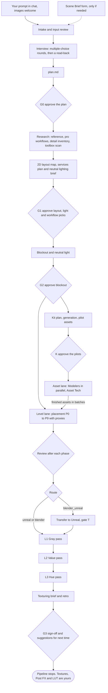

# 3D Scene Pipeline, v6

A Claude Code pipeline that builds a 3D scene or object from real-life photos and concept art with the Unreal Engine 5.8 and Blender 5.2 MCP servers. It starts from a chat prompt, interviews you, plans, builds and lights the scene up to an approved hue pass, then hands off to you for texturing.

- Setup on your PC, and using it from any Claude Code session: [../setup-windows.md](../setup-windows.md)
- Standing rules in one place: [`house-rules`](../../.claude/skills/house-rules/SKILL.md)
- Parallel agents: [parallel.md](parallel.md)
- Input form (optional): [pages/scene-brief.html](pages/scene-brief.html)
- Review board: [pages/gate-review.html](pages/gate-review.html)
- Agents: [`.claude/agents/`](../../.claude/agents) · Skills: [`.claude/skills/`](../../.claude/skills)
- What changed and what to try next: [improvements.md](improvements.md)

The HTML pages are the sources of the published Claude artifacts. The form and board store data through the artifact runtime, so they only work fully when opened as artifacts.

## Stack

| Choice | Effect |
| --- | --- |
| Unreal Engine 5.8, about 80% of work | Epic's ModelContextProtocol plugin (`unreal-mcp` in `.mcp.json`) and Epic's Claude Code plugin. Final assembly, PCG, lighting passes and captures on the game routes |
| Blender 5.2, about 20% | Blender Lab MCP server v1.0.3 (`blender` in `.mcp.json`) for the live session, headless Blender for per-asset work. All modelling; the whole scene on the Blender routes |
| Tripo and Magnific, only for detailed work | Generated props when `detail` is `detailed` or `final` and you have answered the credit question (`tripo-props`, `generated-asset`), then cleaned up to spec. Magnific also does images and stock reference search |
| Windows | Paths and the toolbox scan default to Windows installs |

## Mode, detail and tier

The default job is a **detailed** build from the references, with a flat colour per material group for you to texture. Final assets come later, generated or made by hand. You set three things in the prompt (or in the interview):

- **Mode:** `blockout` (default; light stays neutral until the modelling is done, then follows the reference's mood), `camera_match` (also matched to a photo's camera), or `full_cg` (a finished CG scene with measured light and real-world values).
- **Detail:** `massing` (volumes at real scale, no small parts), `detailed` (default; every feature the references show, from `plan/inventory.yaml`) or `final` (also finished assets). Defined once in `.claude/skills/scene-pipeline/SKILL.md`.
- **Tier:** S, M or L. It sets research depth, how often reviews run and which gates wait for you. One photo of one room is S.

A gate passes only with a supervisor PASS plus your approval. Add "autopilot" to the prompt to have the gates posted for the record while the pipeline carries on with their defaults. Solved problems live in [`knowledge/`](../../knowledge) and are read before any research. Details: `.claude/skills/scene-pipeline/SKILL.md`.

## Routes

| Route | Built in | Lit in | Use for |
| --- | --- | --- | --- |
| `unreal` | Unreal, with models from Blender | Unreal | Game scenes, the default |
| `blender_unreal` | Blender, then transferred | Unreal | Game scenes you'd rather assemble in Blender |
| `blender` | Blender | Blender Cycles | CG stills, turntables and shots |

Details: [routes.md](routes.md).

## Flow

After G2 two lanes run at once: the asset lane builds kit pieces and props headless, several Modelers at a time, while the route's worker places phases with proxies and swaps finished assets in. Every gate posts to the Gate Review Board and waits for your decision. Every build step ends with a lint run, then the supervisor and the Art Director review from the same camera set, and the manager merges their notes and yours into one fix list. Projects stay local: a save point is a log line, a backup and a ledger entry, and only changes to the pipeline itself are committed and pushed.

## Documents

| File | Contents |
| --- | --- |
| [stages.md](stages.md) | Each stage's inputs, work, outputs, agents and exit rule |
| [routes.md](routes.md) | The three build routes and the Blender to Unreal transfer |
| [lighting.md](lighting.md) | Lighting brief, neutral rig, the gray, value and hue passes, the pass switch |
| [agents.md](agents.md) | Agents, models, the interview, the Modeler, the Asset Tech, Generator and pipeline clerk, the toolbox scanner, researchers and the retro |
| [parallel.md](parallel.md) | What runs at the same time, what stays single, and the settings |
| [studio-workflows.md](studio-workflows.md) | How game and VFX studios staff and run environment work, and what v4 took from it |
| [data-and-commits.md](data-and-commits.md) | Project folder layout, `brief.yaml` keys, data contracts for the form and board, save points and commits |
| [improvements.md](improvements.md) | What changed in v5 and v4, suggestions, and what still needs a test |
| [schemas/](schemas/) | JSON Schemas for the brief, gate entries, feedback, the palette and the toolbox manifest |
| [examples/](examples/) | The hotel corridor example used on the board |

## Status

The skills and agents are written. The toolbox scan script is tested. The Blender scripts are tested headless against Blender 5.2's Python module; the Unreal scripts are sketches to verify on the first project. See [improvements.md](improvements.md#test-on-the-first-project).
